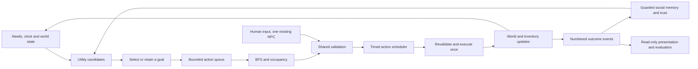

# Actual offline AI architecture

## One shared simulation

The application entry point is `python -m civsandbox`. Configuration creates a local provider and one Simulation, then exact headless ticks or the Pygame loop. Simulation has no Pygame dependency. Four stable identities own authoritative position, hunger, energy, inventory, numeric personality, directed trust and memory. Rendering observes that state; interpolation never changes logical coordinates.

## Utility-based goal selection

RuleBasedDecisionProvider in decisions.py builds valid candidate goals: eat, gather, hunt, cook, rest, socialize, help, request help, avoid a recent serious dispute, explore or wait. A Candidate in planning.py stores component scores, a target, a short public explanation and executable steps. Utility is the sum of manually specified benefit/urgency and cost terms. These include needs, edible inventory/nutrition, resource availability, travel, pursuit/cooking/wait cost, daylight, personality and guarded social trust. Weights are authored code, not fitted/trained models.

Emergency eating with carried food at hunger 85+ overrides optional goals; low energy favors recovery. Incoming requests have high priority when safe. Preferred night rest can be interrupted by urgent food needs. Personalities change numeric terms and social willingness rather than giving named NPCs special food, movement or sharing exemptions. Selection uses deterministic tie-breaking and seeded randomness only in declared places. Hunting receives a bounded −12 to +26 utility adjustment at new eligible goal selection, not every tick. Social willingness/exploration also use seeded choices. No probability quota forces hunting or cooperation.

The rule provider uses a known full resource map for berry routing. Nearby social opportunities require physical proximity; hunting targets are bounded by six-tile visibility plus reachable risk-limited pursuit distance. This is not a fully vision-limited agent. The mock adapter uses a restricted structured observation view and can explore unknown visible resources; it is a test adapter with its own fallback/cooldown behavior, not interchangeable research data from a language model.

## Bounded multi-step planning

GoalPlan is a forward task queue of one to six actions, not a general-purpose search over arbitrary future states. Examples:

- Reach bush → timed GATHER → EAT berries.
- Bounded HUNT/pursuit → travel beside campfire → timed COOK → EAT cooked chicken.
- Reach a nearby shelter when useful → timed REST units until the chosen recovery target.

Successful movement/inventory changes advance the queue. Useful valid plans persist instead of reselecting each frame. Completion, invalid targets, failed execution, urgency, incoming requests and bounded deadlines trigger reevaluation. Plans expire after 320 ticks or 80 ticks without progress; failed goal/target pairs receive a short retry delay. Pursuits have their own shorter bounds. PLAN and GOAL_SELECTED events expose outcomes/choices without altering decisions or RNG consumption.

Night rest can select brief WAIT plans repeatedly while energy is high; measured frequent rest-goal reselection is a routine scheduling artifact, not evidence of learning or a deadlocked chase. Evaluation records activity time and failures so this behavior is visible.

## BFS, occupancy and execution

World.path uses unweighted breadth-first search over four walkable neighbors, giving a shortest tile route. The 24×18 grid bounds the search. Occupancy tries an avoiding BFS route, waits briefly at contested passages, then permits bounded corridor passing after three blocked ticks. Temporary tile overlap is a documented recovery compromise, not strict multi-agent collision exclusion. No terrain teleport or blocked-tile exemption exists.

All sources return the frozen Action model. actions.py owns validation and atomic effects; pacing.py owns fixed-tick work, reservations, progress and final validation. A changed/depleted resource can invalidate work between selection and completion. Rejection safely produces WAIT without food. Resource stocks, authoritative Inventory, cooking conversion and chicken rewards update only at validated completion. User commands go through the same route/timing/validator/executor. Only actual incapacitation forces recovery for a human-controlled agent; the normal provider never chooses that agent's voluntary actions.

## Social finite-state behavior, trust and memory

SocialSystem owns shared PROPOSED/APPROACHING/WAITING_FOR_PARTNER/ENGAGED/RESOLVING/COMPLETED/CANCELED sessions, real addressed food requests, availability, cooldowns and consequences. Both partners must physically meet, stop and face before accepted speech. Busy/separated/urgent/timed-out sessions release safely. Food transfers conserve quantities; answers require live request IDs. Voluntary offers use the same inventory validation.

Trust is directed and clamped to −100…100. Greetings have small effects, successful help larger effects, and ordinary refusal modest or zero effects depending on need/supply. Numeric trust-gain traits scale actual consequences. Each important event records one relevant memory per participant in the existing bounded 20-record history. Memories do not learn a statistical model; they are experience records used by explicit code. Decision willingness, target choice, temporary avoidance and authored dialogue read history only through guarded accessors.

MEMORY_OFF returns empty historical recall and neutral trust to decisions/dialogue. Current needs, inventory, observations, requests, action commitment, cooldowns and mechanical retry state remain. Audit trust/memories can still be collected for analysis but are not input through other prompt/policy fields. Every trial creates fresh agents/providers/caches with no persisted history. Memory availability also changes eligible authored greeting banks; text length can affect session duration and downstream timing, so evaluations do not isolate a single trust coefficient.

## Wildlife and survival finite-state rules

wildlife.py owns living Chicken entities in the same world: IDLE → WANDER or FLEE, then return to idle/rest after bounded fear/calm intervals. Movement is seeded and avoids blocked terrain, water and occupied/reserved spawn tiles. Default initial population is two; delayed replacements restore it within a maximum cap. New IDs are monotonic. No spawn callback commands an NPC to hunt.

Hunting eligibility considers needs, carried meals/raw reserve, energy, distance/risk, berry alternatives and reachable cooking. A claim prevents duplicate hunters/rewards. The scheduler pursues through ordinary BFS/occupancy, repaths as the chicken moves, and enforces time/distance/energy/cooldown limits. A continuous adjacent catch window must finish before one validated raw reward. Cooking holds one shared station lease and atomically converts one raw item to one cooked item; raw meat is inedible. Nutrition is centralized in inventory.py.

daynight.py derives time from .25-second ticks; survival.py derives consequences from the same needs. Hunger grows toward 100 and energy falls toward zero, with configured slowdown, temporary incapacitation, real REST recovery and starvation grace. Permanent NPC death is not modeled. Mortality survival therefore cannot honestly be reported as 100%.

## Modules and presentation/persistence

| Responsibility | Modules |
| --- | --- |
| World/connectivity and resources | world.py, resources.py, occupancy.py, cooking.py |
| Agent identity/state/items | agents.py, characters.py, inventory.py |
| Local decisions/plans and structured adapter | decisions.py, planning.py, perception.py, ai.py |
| Validation, time and orchestration | actions.py, pacing.py, simulation.py, survival.py, daynight.py |
| Social sessions and authored turns | social.py, dialogue.py |
| Human source and consent UI | player.py, participant_ui.py |
| Original art and observed-step animation | sprites.py, animation.py |
| HUD/feedback and bounded histories | rendering.py, ui_state.py, feedback.py, history.py |
| Full-world checkpoint | savegame.py |
| Isolated evaluation and charts | experiments.py, measurements.py, results.py |

Rendering caches original frames, portraits, terrain variants and lighting. Actual cardinal moves select walk rows; advanced actions use idle fallbacks and honest indicators. Speech is accepted-event-driven, with an independent readable real-time queue. Normal UI hides diagnostics; F3 exposes actual utilities/plans/validation. Window scaling changes final presentation/mouse coordinates only.

Version-1 atomic JSON checkpoints restore committed physical/social/resource/wildlife/configuration/RNG state, mode and selection after complete validation. Live jobs/claims/plans/sessions clear without unfinished rewards. Full-world loading never rewrites unrelated legacy social files. No persisted action/log is executed. Experiments never load game saves or import presentation.

## Compatibility and explicit non-claims

DecisionProvider.decide(agent, world, resources, rng) → Action remains the extension boundary. ai.py retains tested historical external-adapter compatibility code; the normal factory/CLI cannot enable it, and Google SDK is not required. Archived phase1a is preserved and not imported by the main game. No neural network, ML training, LLM, arbitrary generated-code execution, general-purpose theorem prover or open-ended language generation is implemented. The project is an explainable classical AI sandbox.
